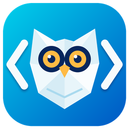

# Hootedit

<p align="center">
  
</p>

A fast native code editor in C++. No Electron, no GTK, no web view: the text path is our own code (piece-table buffer, chunked line index, table-driven syntax engine, own regex and fuzzy matcher), drawn with the OpenGL glyph-atlas renderer and terminal engine from [Lestrix](https://github.com/BeanGreen247/lestrix). It is quiet and dark, with no minimap, no breadcrumbs and no animations, and it is built for people who notice latency.

## Install

```
./install.sh              # asks: system-wide (/usr/local) or just for you (~/.local)
./install.sh --user       # ~/.local, no sudo for the files
./uninstall.sh            # removes it again
```

Needs SDL2, FreeType, fontconfig and OpenGL; the installer fetches the build packages for apt, dnf, pacman and zypper. Run `hootedit [FILE|FOLDER...]`. More in [docs/install.md](docs/install.md).

## What it does

- **Editing** like VS Code and Sublime Text: tabs with preview, select next occurrence (Ctrl+D), command palette (Ctrl+Shift+P), quick open with live preview (Ctrl+P), Find and Replace with regex, outline, themes. [Sidebar, Explorer and tabs](docs/explorer-and-tabs.md), [editing details](docs/editing.md), [all shortcuts](docs/shortcuts.md).
- **Settings page** (Ctrl+,): vim keys, live checks, themes, git, terminal and the rest in one searchable place. [docs/settings.md](docs/settings.md)
- **Vim keys** as a toggle: modes, operators and text objects, registers, macros, `:s`, `:g`, block mode, surround. [docs/vim.md](docs/vim.md)
- **Live checks** for common mistakes while you type: Ansible playbooks (the ansible-lint rules that can be decided from the text), Kubernetes manifests, YAML, JSON, TOML, XML, shell, Python, C/C++, JavaScript, SQL, CSS, Dockerfile and more, with one-key fixes and correct skeletons to insert. [docs/live-checks.md](docs/live-checks.md)
- **Source control**: staged and changed files, graph, blame, diff and merge tabs, rebase, stash, branches. [docs/git.md](docs/git.md)
- **Remote** tabs over ssh, sftp, ftp, ftps and smb. [docs/remote.md](docs/remote.md)
- **Search** in files with own regex and fuzzy engines. [docs/search.md](docs/search.md)
- **Terminal panel** with the Lestrix engine. [docs/terminal.md](docs/terminal.md)

## Speed

Measured numbers and how to repeat them: [docs/performance.md](docs/performance.md). Hootedit against VS Code (clean, and your own profile) on the same machine, with the tools to rerun it: [docs/COMPARISON.md](docs/COMPARISON.md). Tests (GoogleTest, the same groups and runner as fleetwm and Lestrix): [docs/testing.md](docs/testing.md). Current state: [docs/status.md](docs/status.md).

## License

MIT, see [LICENSE](LICENSE).
